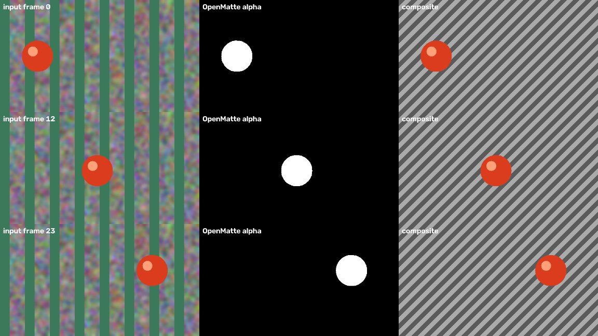

# OpenMatte

Open-source AI mattes for images and video, with a basic Nuke node.

Click on an object and OpenMatte writes an alpha matte for every frame:
[SAM 2.1](https://github.com/facebookresearch/sam2) segments and tracks it, and
[ViTMatte](https://github.com/hustvl/ViTMatte) can turn the hard mask into soft edges.
Optional backends add text prompts ([SAM 3](https://github.com/facebookresearch/sam3)) and video matting
models ([MatAnyone2](https://github.com/pq-yang/MatAnyone2), [VideoMaMa](https://github.com/cvlab-kaist/VideoMaMa)).



> **Status: v0.1.0, early release.** Only the features marked *tested* below have been verified.

## Feature status

| Feature | Status |
|---|---|
| CLI: image, folder of frames, or video in; PNG alpha sequence out | **Tested** |
| Tracking with SAM 2.1 **small** from foreground clicks | **Tested** (synthetic + real footage) |
| Background (negative) clicks, click on a frame other than the first | Implemented, **untested** |
| SAM 2.1 tiny / base+ / large | **Experimental** (same code path as small, not run) |
| ViTMatte soft-alpha refinement | **Tested** (real footage) |
| MatAnyone2 refinement (non-commercial) | **Tested** (real footage, separate environment) |
| VideoMaMa refinement (non-commercial) | **Experimental** (see [Test results](#test-results)) |
| SAM 3 text prompts | **Experimental, untested**: weights are gated; code checked against the `transformers` 5.20 API only |
| Nuke node | **Untested in Nuke.** It compiles under Nuke 15.1's Python, which is *not* an integration test. See [docs/NUKE_TESTING.md](docs/NUKE_TESTING.md) |

## Models and licenses

OpenMatte's own code is **Apache-2.0**. **No model weights or third-party code are included in this
repository**: each model is downloaded from its authors on first use, under its own license.
Code and weight licenses can differ; details and links are in [THIRD_PARTY_NOTICES.md](THIRD_PARTY_NOTICES.md).

| Model | Code license | Weights license | Commercial use |
|---|---|---|---|
| SAM 2.1 | Apache-2.0 | Apache-2.0 | Yes |
| ViTMatte | MIT | Apache-2.0 (model card) | Yes |
| SAM 3 | SAM License | SAM License (gated) | Allowed under its terms |
| MatAnyone2 | S-Lab License 1.0 | S-Lab License 1.0 | **No: non-commercial only** |
| VideoMaMa | CC BY-NC 4.0 | Stability AI Community License | **No: non-commercial only** |

The defaults (SAM 2.1 + ViTMatte or no refinement) are commercially usable.
You are responsible for following each model's license.

## Requirements

- Python 3.10–3.12. Tested on Windows 10; Linux is expected to work but is untested.
- NVIDIA GPU with CUDA strongly recommended. CPU works but is slow (untested at length).
- Disk: ~5 GB for the Python environment plus models (SAM 2.1 small 176 MB, ViTMatte small 99 MB;
  VideoMaMa needs several GB more).
- For the Nuke node: Nuke 13+ (the engine runs in its own Python, so Nuke's Python version does not matter).

## Install

```bash
git clone https://github.com/<you>/openmatte.git
cd openmatte
python -m venv .venv
# Windows: .venv\Scripts\activate      Linux: source .venv/bin/activate
pip install torch torchvision --index-url https://download.pytorch.org/whl/cu128
pip install -e .
```

- **Windows:** set `SAM2_BUILD_CUDA=0` before `pip install -e .` to skip SAM 2's optional CUDA extension.
  You will then see a harmless `cannot import name '_C'` warning (it only affects small-hole filling).
- **Windows:** keep the project in a short path such as `C:\dev\openmatte`. PyTorch failed to load its DLLs
  from a ~200-character path during testing.
- **Reproducible install:** `requirements-tested.txt` pins the exact versions used for the tests below.

Check the install:

```bash
python tests/test_example.py     # generates the example, mattes it, checks IoU >= 0.9 against ground truth
```

### Optional: SAM 3 (text prompts, experimental)

Request access at <https://huggingface.co/facebook/sam3>, then log in once inside the venv with `hf auth login`.

### Optional: MatAnyone2 (non-commercial)

MatAnyone2 pins `huggingface_hub==0.36.2`, which conflicts with `transformers 5`, and its package does not
build with current pip (hatchling "second file is being added" error). It therefore runs from its own clone
and environment:

```bash
git clone https://github.com/pq-yang/MatAnyone2.git third_party/MatAnyone2
python -m venv third_party/ma-venv
third_party/ma-venv/Scripts/pip install torch torchvision --index-url https://download.pytorch.org/whl/cu128
third_party/ma-venv/Scripts/pip install opencv-python tqdm typer "imageio[ffmpeg]" pillow numpy scipy einops hydra-core omegaconf easydict av huggingface_hub safetensors kornia requests
```

```bat
set OPENMATTE_MATANYONE2_DIR=C:\dev\openmatte\third_party\MatAnyone2
set OPENMATTE_MATANYONE2_PYTHON=C:\dev\openmatte\third_party\ma-venv\Scripts\python.exe
```

### Optional: VideoMaMa (non-commercial, experimental)

```bash
git clone https://github.com/cvlab-kaist/VideoMaMa.git third_party/VideoMaMa
pip install -e ".[videomama]"
```

```bat
set OPENMATTE_VIDEOMAMA_DIR=C:\dev\openmatte\third_party\VideoMaMa
```

The parts of Stable Video Diffusion that VideoMaMa loads (about 1.4 GB) and the VideoMaMa weights download
automatically on first use.

## Usage

Coordinates are pixels with a top-left origin.

```bash
# SAM 2.1 from clicks. Use 2-3 clicks on different parts of the object:
# in testing, a single click on a child's shorts selected only the shorts.
openmatte plate.mp4 -o alpha/ -p 260,160 -p 230,260 -p 210,350

# soft edges
openmatte plate.mp4 -o alpha/ -p 260,160 -p 230,260 --refine vitmatte

# clicks on frame 12 plus a background click (untested)
openmatte plates/ -o alpha/ -p 420,310 -n 600,80 -f 12

# every match of a text prompt, merged into one matte (SAM 3, experimental)
openmatte plate.mp4 -o alpha/ --text person
```

Options: `--tracker sam2-tiny|sam2-small|sam2-base|sam2-large|sam3`,
`--refine none|vitmatte|matanyone2|videomama`. Output is one 8-bit grayscale PNG per input frame,
named like the input frames (videos: `00000.png`, `00001.png`, …).

## Nuke node (untested in Nuke)

1. Add the `nuke` folder to your plugin path in `~/.nuke/init.py`: `nuke.pluginAddPath("C:/dev/openmatte/nuke")`
2. Set `OPENMATTE_PYTHON` to the venv's python, or fill the node's *engine python* knob.
3. **Nodes → OpenMatte → OpenMatte**, connect a plate, pick a tracker, drag *click point* onto the object on
   the *click frame* (or type a *text prompt* for sam3), set the frame range, press **Generate matte**.

The node renders its input to 16-bit PNG, runs the engine out of process, and copies the result into the
alpha. Step-by-step test instructions: [docs/NUKE_TESTING.md](docs/NUKE_TESTING.md).

## Test results

Hardware and software: Windows 10 Pro (build 19045), NVIDIA GeForce RTX 4080 SUPER 16 GB (driver 610.62),
Python 3.11.5, torch 2.11.0+cu128, transformers 5.20.2, diffusers 0.42.0, SAM 2 commit `2b90b9f`.
Timings include model loading; first runs also include downloads.

| Test | Input | Result |
|---|---|---|
| `tests/test_example.py`: SAM 2.1 small vs ground truth | synthetic, 24 frames 640×360, 1 click | **Pass.** IoU min 0.987, mean 0.995 |
| SAM 2.1 small, real footage | 200 frames 960×540, 1 click | Ran, but selected only part of the subject (shorts) |
| SAM 2.1 small, real footage | same, 3 clicks | **Pass** (visual check). Whole subject tracked through a full occlusion; 13 s |
| + ViTMatte | same, 200 frames | **Pass.** 256 alpha levels, soft motion-blur edges; 35 s total (~9 fps refine) |
| + MatAnyone2 | first 48 frames | **Pass** (visual check), with a faint ghost of an occluding person on one frame; 49 s incl. downloads |
| + VideoMaMa | first 16 frames | **Not yet verified**: the first run was still downloading its 6.1 GB of weights at release time |
| SAM 3, `--text boy` | real footage | **Not run**: gated weights (clear error message verified) |
| Nuke node in Nuke 15.1 | — | **Not run**: no Nuke license available for terminal mode; compiles under Nuke's Python 3.10.10 |

The real-footage clip used for testing is the `bedroom.mp4` sample from the SAM 2 repository. It is not
included here because its redistribution terms are not stated.

## Limitations (v0.1)

- One object (or one merged text prompt) per run; no box prompts, no per-object outputs.
- The Nuke node takes a single click point; the CLI accepts several.
- Nuke's UI is blocked while the engine runs.
- Frames are converted to 8-bit sRGB for the models.
- The whole clip is held in memory, and ViTMatte runs at full resolution; very long or 4K+ shots may need
  splitting (untested).
- MatAnyone2 propagates only forward from the click frame.
- VideoMaMa processes independent 16-frame chunks at 1024×576, so it can flicker at chunk boundaries.

## Contributing

Bug reports and pull requests are welcome; see [CONTRIBUTING.md](CONTRIBUTING.md).

## License

Apache-2.0 for OpenMatte's code. Model licenses: [THIRD_PARTY_NOTICES.md](THIRD_PARTY_NOTICES.md).
